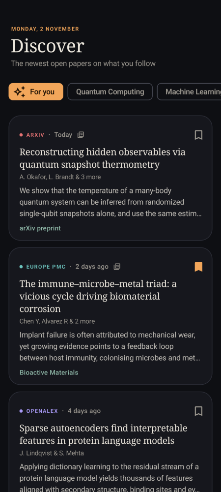
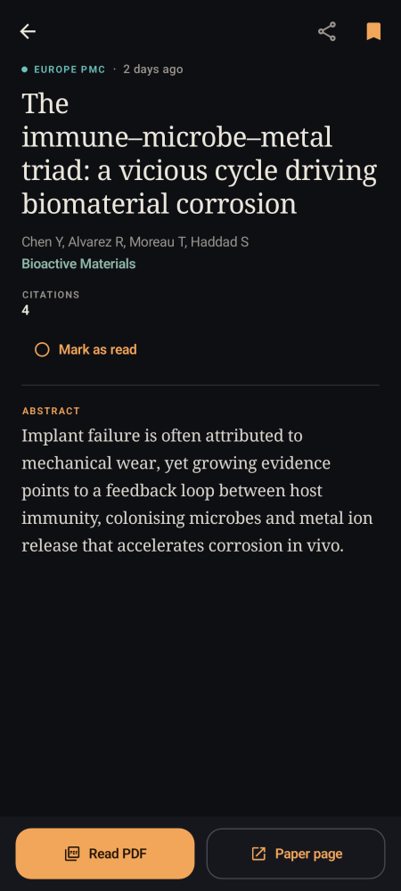
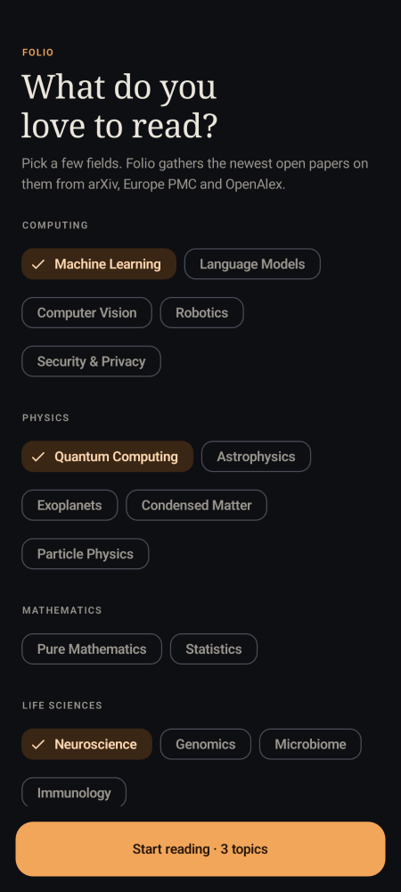

# Folio: an open papers library for Android

Folio gathers new open-access research papers on the topics you follow, so you don't have to go
looking for them. It pulls from three free sources:

| Source | Covers |
|---|---|
| [arXiv](https://info.arxiv.org/help/api/) | Preprints in physics, maths, CS, quantitative biology, stats, economics |
| [Europe PMC](https://europepmc.org/RestfulWebService) | Open-access life-science and biomedical papers, including preprints |
| [OpenAlex](https://docs.openalex.org) | An open catalogue of scholarly works in every field |

| Discover | Paper | Onboarding |
|---|---|---|
|  |  |  |

## What it does (v0.1)

- **Onboarding**: pick fields from 23 topics in 8 areas.
- **Discover**: the newest papers across everything you follow ("For you"), or one topic at a
  time. Results from all sources are merged, duplicates are removed (by DOI, then title), and the
  list scrolls without end. Pull down to refresh.
- **Search**: free-text search across all three sources, with results interleaved by relevance.
- **Paper page**: full abstract, authors, venue, citations and DOI. Opens the PDF or the
  publisher page in a Custom Tab. You can also share the paper or jump to related tags.
- **Library**: bookmark papers to keep them on the device, with "To read" and "Read" shelves.
  Swipe a paper away to remove it, with undo.
- **Settings**: edit your topics and add an optional OpenAlex API key.

## Stack

Kotlin, Jetpack Compose with Material 3, Navigation Compose, OkHttp, kotlinx.serialization and
DataStore. There's no backend and no account; everything lives on the device. Dependencies are
wired by hand in `FolioApp.kt`.

```
app/src/main/java/com/folio/papers/
  data/            Paper model, topic catalogue, repository (merge/dedupe/paging), on-device library
  data/sources/    ArxivSource (Atom XML), EuropePmcSource (JSON), OpenAlexSource (JSON)
  ui/theme/        Ink & paper palette, serif titles, one accent colour per source
  ui/components/   PaperCard, skeletons, infinite feed, FeedController
  ui/discover, ui/search, ui/library, ui/detail, ui/topics
```

## Build

Requires JDK 17+ and the Android SDK (platform 35).

```bash
./gradlew assembleDebug          # app/build/outputs/apk/debug/app-debug.apk
./gradlew installDebug           # onto a connected phone or emulator
./gradlew assembleRelease        # minified; signed with the debug key until a real key is set up
```

## Tests

```bash
./gradlew testDebugUnitTest                    # offline; the live API checks skip themselves
./gradlew testDebugUnitTest -Dlive=true        # also hit arXiv, Europe PMC and OpenAlex for real
./gradlew verifyPaparazziDebug                 # compare screens against the stored screenshots
./gradlew recordPaparazziDebug                 # re-record them after a UI change
```

## Notes on the sources

- Without a key, OpenAlex shares a small daily budget across everyone on the same IP address, and
  it sometimes pauses anonymous search when it's busy. When that happens the feed keeps working
  from the other sources and says what went wrong at the bottom of the list. A free key
  (Settings → OpenAlex key) gives each reader their own budget.
- arXiv asks for gentle use. Folio sends one combined query per page, not one per topic.

## Ideas for next steps

- Reading-time estimates and a "today's five" digest, with a daily notification (WorkManager)
- In-app PDF reader with highlights and notes
- Better ranking: learn from what you save and read, and follow authors
- More sources: bioRxiv/medRxiv, DOAJ, Semantic Scholar, CORE
- Room database for the library, export to BibTeX or Zotero
- Light theme polish, dynamic colour, tablet layout
