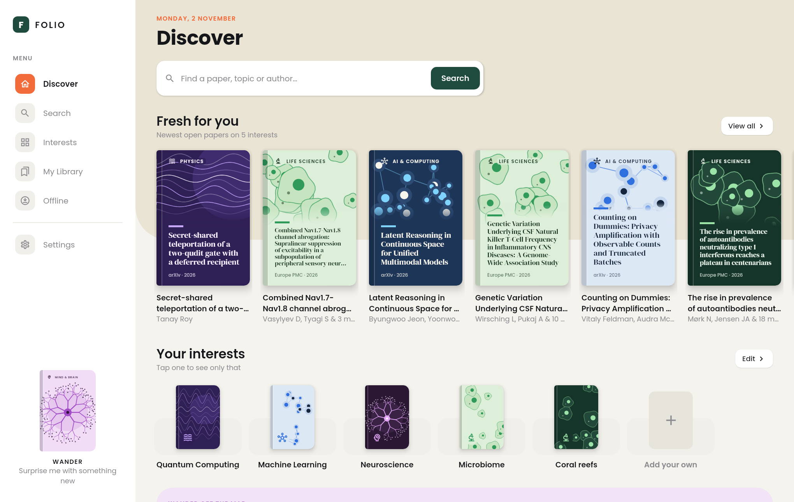
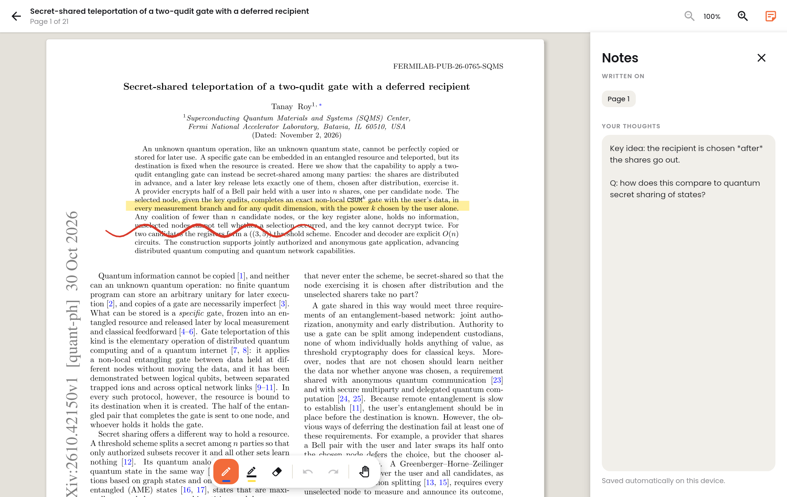
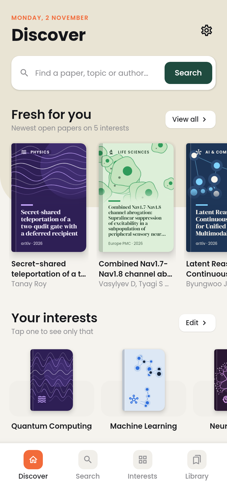
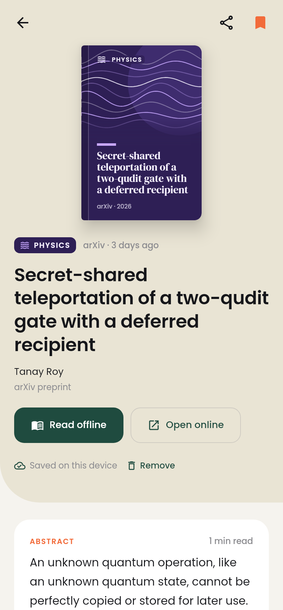
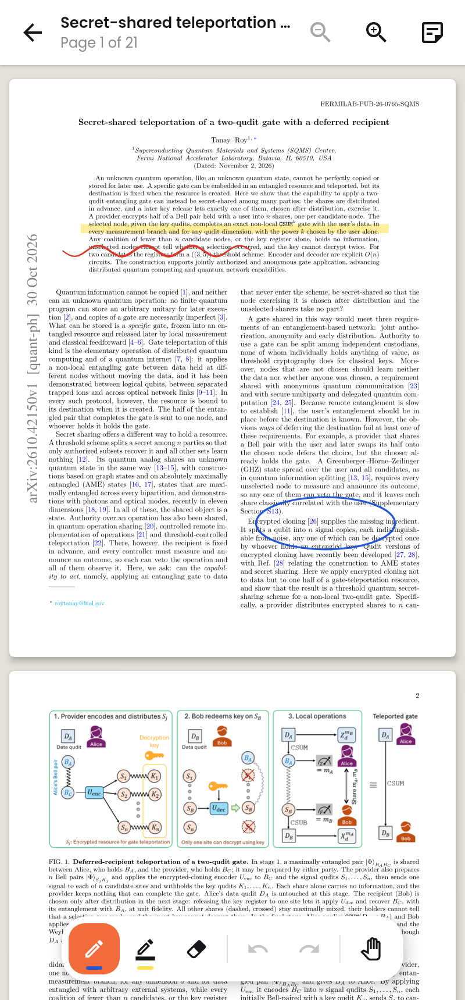
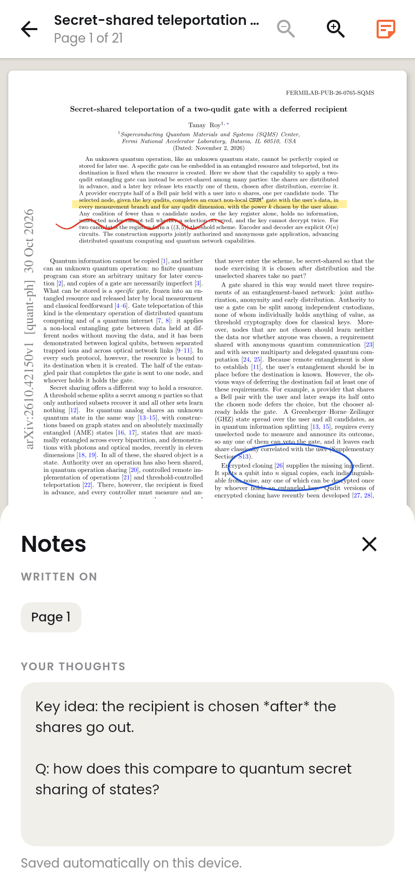

# Folio: an open papers library

Folio collects new open-access research papers on whatever you're curious about and turns them
into a bookshelf you can browse, save and read offline. It runs on **Android** and **desktop**
(Windows, macOS, Linux) from one Kotlin codebase built with
[Compose Multiplatform](https://www.jetbrains.com/compose-multiplatform/). The shared code avoids
JVM-only APIs, so an **iOS** target can be added later.

Papers come from three free sources:

| Source | Covers |
|---|---|
| [arXiv](https://info.arxiv.org/help/api/) | Preprints in physics, maths, CS, quantitative biology, stats, economics |
| [Europe PMC](https://europepmc.org/RestfulWebService) | Open-access life-science and biomedical papers, including preprints |
| [OpenAlex](https://docs.openalex.org) | An open catalogue of scholarly works in every field |





| Phone: Discover | Paper | Reading with a pen | Notes |
|---|---|---|---|
|  |  |  |  |

More in [docs/screenshots](docs/screenshots), including dark mode and the full Discover page.

## Features

- **Generated covers.** Papers have no cover art, so Folio draws one for each paper. It works
  out the paper's field from its arXiv category or keywords: AI & computing, physics, space,
  maths, life sciences, health, mind & brain, earth & climate, materials & energy, society, or
  history & culture. Then it draws a motif for that field (networks, waves, orbits, cells, pulse
  lines, contour maps, crystal lattices…) in the field's colours and sets the title like a book
  cover. The same paper always gets the same cover, so the subject is clear at a glance.
- **Any interest you like.** Type anything ("coral reefs", "sourdough microbes", "Byzantine
  history") and Folio follows it. You can also pick from 23 popular fields, or tap
  **Follow topic** on any search.
- **Discover**
  - *Fresh for you*: the newest papers across your interests, mixed from all sources.
  - *Your interests*: one tile per topic, each opening its own feed.
  - *Curiosity shelf*: papers on subjects **outside** your interests (octopus intelligence,
    Roman concrete, fast radio bursts…). It picks new subjects every day, and Shuffle picks more.
  - *More new papers*: the list continues as you scroll.
- **Built-in PDF reader.** **Read** opens the paper inside Folio; no browser or external viewer.
  The PDF is fetched in the background into a small cache (the last 25 papers). Zoom, page
  memory, and papers you've read are marked read.
- **Write on papers.** Pen (6 colours, 3 widths, pressure-sensitive), highlighter (5 colours),
  and an eraser that removes whole strokes. The stylus's eraser end and barrel button erase
  too. Undo/redo with buttons or Ctrl+Z / Ctrl+Y.
  - *Palm-friendly by default:* only the stylus writes, while fingers and mouse scroll. The ✋
    button lets fingers and mouse write too (for devices without a pen).
  - *Typed notes:* a notes panel per paper, with a list of the pages you've written on.
  - *Kept for you:* writing on a paper saves it to your library and keeps its PDF offline. Notes
    preview on the paper's page.
- **Offline.** **Save offline** keeps a paper's PDF permanently; it then appears on the
  **Offline** shelf.
- **Library.** Saved papers as a bookshelf, with All / To read / Read / Offline shelves.
- **Adaptive layout.** Phones get a bottom bar. Tablets and desktop (840 dp and wider) get the
  sidebar layout. Light and dark themes, or follow the system.

## Windows and the Surface Pen

The desktop app runs on Windows 10/11 and is tuned for pen tablets such as the Surface Pro. Java
on Windows normally sees a pen as a plain mouse. Folio listens to Windows' own pointer messages
(`WM_POINTER` / `GetPointerPenInfo`, in `desktopMain/.../WindowsPen.kt`) to get:

- **pressure**, so lines get thicker as you press;
- the **eraser end** (flip the Surface Pen) and the **barrel button**, which erase;
- **pen vs. finger**, so the pen writes while a finger or palm scrolls the page.

It also turns off Windows' press-and-hold right-click and flicks inside the window, so they don't
interrupt handwriting. If any of this is unavailable, the pen falls back to working like a mouse.

**Getting the Windows app.** Installers are built by GitHub Actions
(`.github/workflows/folio-builds.yml`) on every push that touches `folio/`. Open the latest
**Folio builds** run under the repository's **Actions** tab and download the **Folio-windows**
artifact. It contains:

- `Folio-1.1.0.msi`: per-user installer (no admin prompt), with Start-menu entry and desktop shortcut;
- `Folio-1.1.0.exe`: the same as an .exe installer;
- `Folio-windows-portable.zip`: no install; unzip and run `Folio.exe`.

The installers aren't code-signed, so Windows SmartScreen may warn the first time: choose
*More info → Run anyway*. The same run builds the Android APK (**Folio-android**).

To build locally on a Windows machine: `gradlew.bat :composeApp:packageMsi`.

## Project layout

```
composeApp/src/
  commonMain/   everything shared: data sources, feeds, library store, downloads, all UI
    data/                 Paper/Topic models, Repository (merge, dedupe, paging), Store, Downloads, Curiosity
    data/sources/         ArxivSource (Atom), EuropePmcSource, OpenAlexSource (JSON) on Ktor
    ui/cover/             Field classifier + generative cover art
    ink/                  Pen input model, strokes, undo/redo, drawing
    ui/screens/           Home, Search, Interests, Library, Paper, Reader, Topic feed, Settings, Shell
  androidMain/  MainActivity, Custom Tabs, share sheet, PDF rendering with PdfRenderer
  desktopMain/  Window, system browser, clipboard, PDF rendering with Apache PDFBox, Windows pen input
  desktopTest/  live API checks and a screenshot tour of the real app
```

The platform layer is small. The `Platform` interface covers file storage, opening links,
sharing and opening PDFs. Each target implements it in about 100 lines.

## Build and run

Requires JDK 17+. Android also needs the Android SDK (platform 35).

```bash
./gradlew :composeApp:run                    # desktop app
./gradlew :composeApp:packageDistributionForCurrentOS   # .dmg / .msi / .deb installer
./gradlew :composeApp:assembleDebug          # Android APK in composeApp/build/outputs/apk/
./gradlew :composeApp:installDebug           # onto a connected phone
```

## Tests

```bash
./gradlew :composeApp:desktopTest                                   # offline: live checks skip
./gradlew :composeApp:desktopTest -Dlive=true                       # parse real arXiv / Europe PMC / OpenAlex
./gradlew :composeApp:desktopTest -Dlive=true -DshotsDir=/tmp/shots # also screenshot every screen
```

The screenshot tour drives the real app headlessly at phone and desktop sizes against the live
APIs. Along the way it downloads a real PDF, opens it in the reader and writes on it with
injected pointer input. On the Windows CI runner, `WindowsPenTest` injects a synthetic pen through
Windows' own input stack and checks that Folio reads pen, pressure and the eraser end.

## Notes

- Without a key, OpenAlex shares a small daily budget across everyone on the same IP address, and
  sometimes pauses anonymous search. When that happens the other sources keep working, and the
  list says what happened at the bottom. You can add a free key in **Settings**.
- arXiv asks clients to space out requests; Folio queues its arXiv calls about 1.2 s apart.
- Some publishers only serve a web page, not a PDF. Folio detects this and offers to open the
  paper online instead.
- Fonts: Poppins and DM Serif Display, both under the SIL Open Font License (see `licenses/`).
